<div align="center">

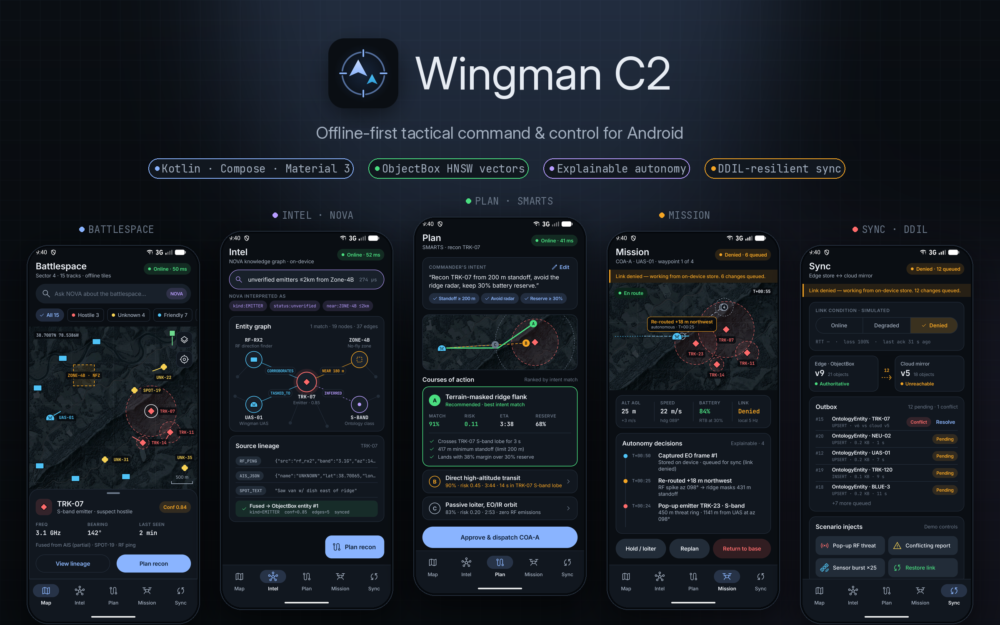

<br/>


**An Android app for command and control at the tactical edge. It fuses messy sensor feeds into a knowledge graph, turns a commander's plain-English intent into ranked, explainable courses of action, and flies a simulated UAS. All of it runs on-device with no network.**

[Tour](#-the-tour) · [Architecture](#-architecture) · [Algorithms](#-algorithms) · [Design system](#-design-system) · [Build](#-build--run) · [Deep dive](docs/ARCHITECTURE.md)

</div>

---

## ✦ Why this exists

Field operators lose connectivity exactly when it matters. Wingman C2 treats the network as a **luxury, not a dependency**:

| | Principle | What it means in code |
|---|---|---|
| 🛰 | **Edge truth** | The UI reads and writes only the on-device **ObjectBox** store. Replication is a background concern behind a transactional outbox. |
| 🧠 | **Explainable autonomy** | Every recommendation carries structured risk sub-scores and a plain-language rationale. Examples: *"Crosses TRK-07 S-band lobe for 3 s"*, *"Re-routed +18 m northwest: ridge masks 431 m standoff"*. |
| 📡 | **DDIL-native** | Denied, Disrupted, Intermittent and Limited links are first-class states. One global `LinkState` drives a chip and banner on every screen. |
| 🧩 | **Swappable backend** | Every remote capability is a port in `core:domain`. Deterministic, seeded simulators stand in for the cloud, so a Dockerized service can replace them without changing a single screen. |

---

## ◎ The tour

<table>
<tr>
<td width="50%" valign="top">

### Battlespace
A live tactical map with MIL-STD-2525-style affiliation symbols, threat rings, no-fly zones and a terrain basemap. Tapping a track opens its fused intel, with confidence and provenance, and hands it straight to planning.

`Canvas`-drawn map · spatial-hash hit testing · zero-allocation draw loop

</td>
<td width="50%" valign="top">

### Intel · NOVA
You ask in plain English, for example *"unverified emitters ≤2km from Zone-4B"*. The query is parsed into typed predicates in microseconds and answered as an entity graph, with full source lineage from raw JSON, RF pings and spot reports to the fused entity.

Natural-language parser · knowledge graph · lineage

</td>
</tr>
<tr>
<td colspan="2" align="center">
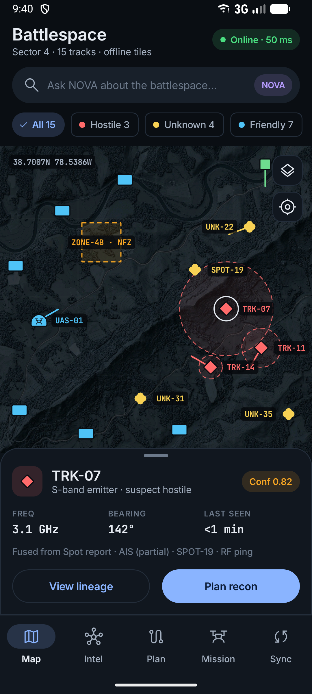&nbsp;
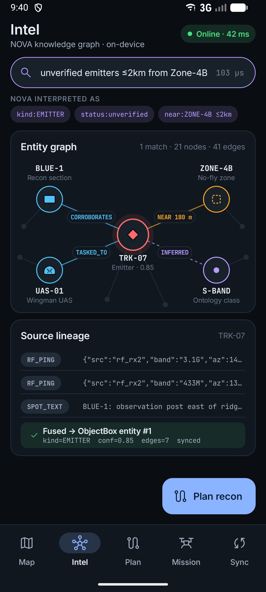&nbsp;
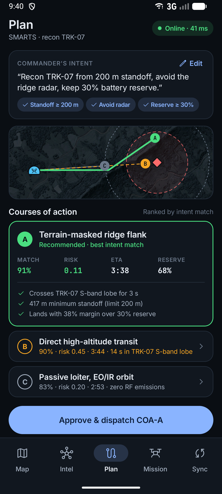&nbsp;
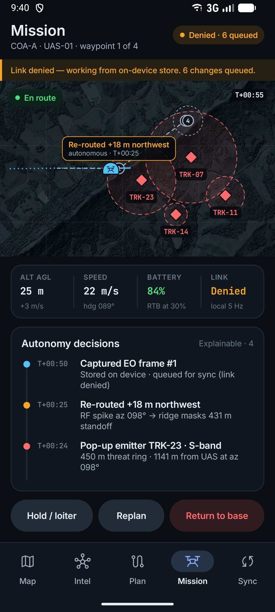
</td>
</tr>
<tr>
<td width="50%" valign="top">

### Plan · SMARTS
*"Recon TRK-07 from 200 m standoff, avoid the ridge radar, keep 30% battery reserve."* The intent becomes constraint chips. Three courses of action are then planned over a terrain-aware cost grid, scored and ranked against the intent:

- a terrain-masked ridge flank
- a direct high-altitude transit
- a zero-emission EO/IR orbit

</td>
<td width="50%" valign="top">

### Mission
A 5 Hz telemetry stream, the flown track and an **autonomy decision log**. When a pop-up emitter appears, the UAS re-plans by itself and explains why. The operator stays *on* the loop with Hold, Replan and Return to base.

Human-on-the-loop · explainable replans · sim-time T+ clock

</td>
</tr>
<tr>
<td width="50%" valign="top">

### Sync · DDIL
- Flip the link between Online, Degraded and Denied, and watch the outbox fill.
- See edge and cloud versions diverge.
- Resolve a real version conflict.
- Inject a pop-up threat, a conflicting report or a sensor burst, all from one demo console.

</td>
<td width="50%" align="center">
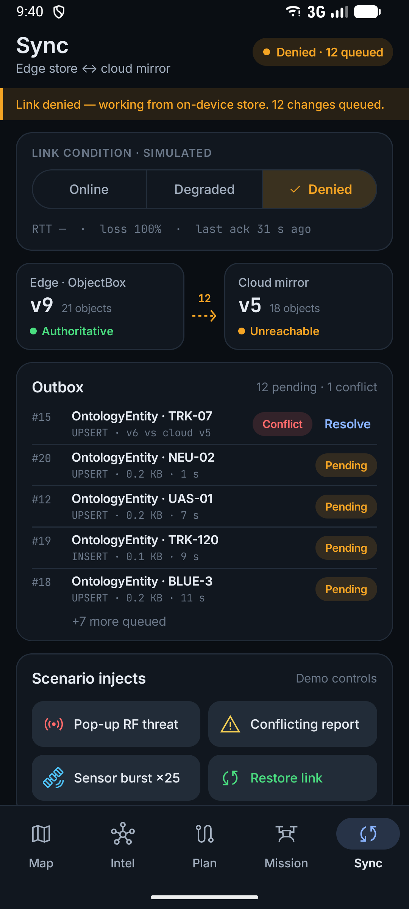&nbsp;
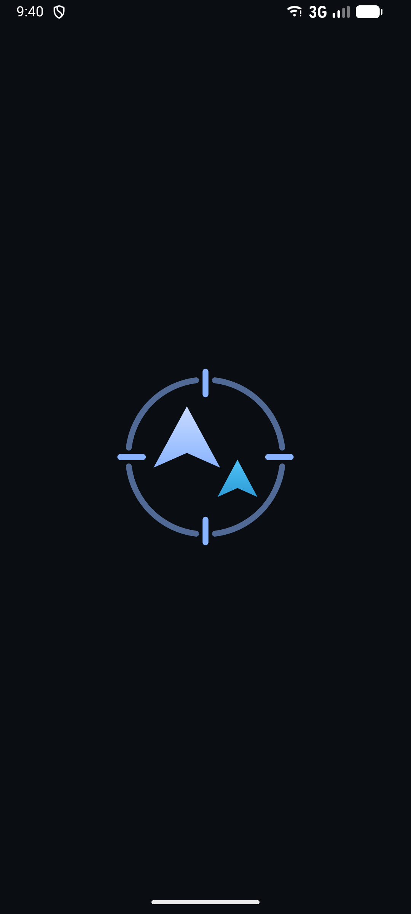
</td>
</tr>
</table>

---

## ⬡ Architecture

The app uses clean architecture enforced by **Gradle module boundaries**, not by convention.

- **Pure-Kotlin JVM modules.** Everything that can be pure Kotlin is a JVM module (`model`, `common`, `algorithms`, `domain`, `simulation`, every `feature:*:domain`), so it compiles fast and cannot reach Android APIs.
- **Self-contained features.** Each feature is a `domain` + `presentation` pair that sees only ports, never the data layer.
- **One composition root.** `app` is the only module that knows about everything.

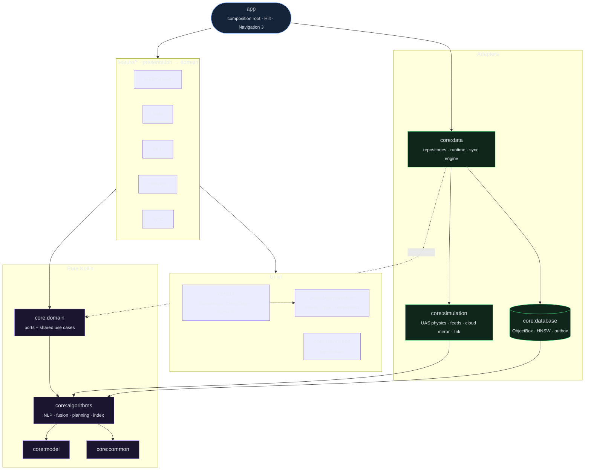

<details>
<summary><b>Build conventions</b>: seven precompiled plugins keep every module file to a few lines</summary>

<br/>

| Plugin | Applies |
|---|---|
| `wingman.android.application` | AGP 9 app, built-in Kotlin, SDK 28 → 37, Java 17, R8 |
| `wingman.android.library` | Shared Android library defaults |
| `wingman.android.compose` | Compose compiler, BOM, tooling |
| `wingman.hilt` | Hilt + KSP |
| `wingman.jvm.library` | Pure Kotlin/JVM module: no Android, fast compile |
| `wingman.feature.domain` | JVM + `api(core:model, core:domain)` |
| `wingman.feature.presentation` | Library + Compose + Hilt + the feature's domain + UI kit + Navigation 3 |

A feature presentation module is just:

```kotlin
plugins { alias(libs.plugins.wingman.feature.presentation) }
android { namespace = "com.wingmanc2.feature.plan.presentation" }
```

Typesafe project accessors, a single version catalog, configuration cache and build cache are all enabled.

</details>

<details>
<summary><b>Patterns used throughout</b></summary>

<br/>

- **Unidirectional data flow.** Each `@HiltViewModel` exposes one immutable `UiState` via `StateFlow`. Lists are `kotlinx.collections.immutable`, so Compose skips stable subtrees.
- **Ports & adapters.** Nine ports, including `OntologyRepository`, `MissionPlannerService`, `TelemetryStreamSource`, `SyncRepository` and `ScenarioController`. There is one adapter set today (on-device), and the port surface is shaped for a remote one.
- **Transactional outbox.** `upsertWithOutbox` writes the entity, its version bump and the outbox event in one ObjectBox transaction, so sync can never observe a half-written state.
- **Navigation 3.** Every tab has its own back stack. Features contribute `EntryProviderScope` extensions, and cross-tab handoff, such as *Plan recon* from the map, goes through a `FocusRepository` instead of route arguments.
- **Cold-start discipline.** The store opens and the scenario seeds on `ApplicationScope` off the main thread, and ports `await` bootstrap readiness instead of racing it.
- **Deterministic simulation.** Every random source is a seeded `SplitMix64`, and frames are stamped in sim time, so a demo run is reproducible.

</details>

---

## ⚡ Algorithms

The app was designed for time and space efficiency from the first commit:

- primitive arrays over boxed collections
- generation stamps instead of clears
- precomputed lookup tables instead of per-query ray marching
- no allocation in the hot draw and physics loops

| Area | Technique | Time | Space |
|---|---|---|---|
| **NL query** (`QueryParser`) | Single-pass lexer → token stream → typed `QueryPredicate`s; unit-aware quantities | O(n) | O(n) |
| **Intent parsing** (`IntentParser`) | Trigger words bind the nearest unclaimed quantity of the right unit within ±4 tokens | O(n) | O(n) |
| **Embeddings** (`FeatureHasher`) | Hashed char n-grams → 64-d L2-normalized vector, no substring allocation | O(L) | O(64) |
| **Vector search** | ObjectBox **HNSW** index, cosine distance | ≈O(log n) | O(n·M) |
| **Spatial index** (`SpatialHashIndex`) | Uniform grid over primitive arrays + open-addressing `LongIntHashMap` | O(1) expected/op; O(cells + k) radius query | O(n) |
| **Entity resolution** (`EntityResolver`) | Spatial gate → RF-band veto → cosine similarity → **log-odds confidence fusion** | O(k·d) per observation | O(1) extra |
| **Raw feed parsing** (`FlatJsonScanner`) | Allocation-light flat JSON scanner for AIS/ADS-B/RF payloads | O(n) | O(fields) |
| **Radar line of sight** (`RadarHorizon`) | Precomputed 360-bin azimuth × 10 m range horizon table, terrain-masked | Build O(A·R), query **O(1)** | O(A·R) |
| **Cost grid** (`CostGrid`) | 128² cells; MASKED and TRANSIT exposure layers filled once per plan; static lee-side penalty fields | O(N·T) | O(N) |
| **Path search** (`GridAStar`) | A* on a primitive indexed binary heap; generation-stamped marks give an O(1) reset; tie-break toward larger g | O(N log N) | O(N) |
| **Path smoothing** (`PathSmoother`) | Shortcut accepted only if an Amanatides–Woo line integral stays within the A* cost budget | O(P·L) | O(P) |
| **Loiter orbit** | Forbidden-interval sweep over radars and no-go circles → safe radius, else largest clear racetrack arc | O(k log k) | O(k) |
| **Replanning** | Cached radar horizons + 8-entry LRU keyed on cell-quantized planning signatures | ~2.7 ms warm vs ~25 ms cold | bounded |
| **Telemetry trail** | Fixed-capacity primitive ring buffer; `Path` rewound in place | O(1)/frame | O(capacity) |
| **Sync backoff** | Seeded, jittered exponential backoff | O(1) | O(1) |

---

## ◐ Design system

<div align="center">
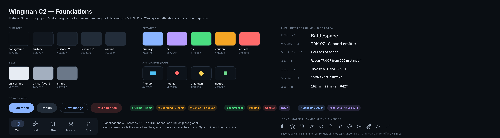
</div>

<br/>

The UI is a dark-first tactical theme tuned for low-light use and glanceability.

- **Color is semantic, never decorative.**
  - **Primary** blue marks interaction.
  - **AI violet** marks machine-generated output (NOVA and SMARTS).
  - **Green, amber and red** mean nominal, degraded and critical.
  - Affiliation colors follow MIL-STD-2525 conventions.
- **Type pairs Inter with JetBrains Mono.** Inter is for language. JetBrains Mono is for anything an operator reads as data: frequencies, bearings, versions, T+ clocks.
- **Components:** link chip, DDIL banner, constraint chips, COA cards, decision timeline, outbox rows, affiliation symbols.

The designs are code, not hand-pushed pixels:

| Asset | How it's made |
|---|---|
| Screen designs | [`design/tools/gen.py`](design/tools/gen.py) generates every frame programmatically into a FigCraft document from shared tokens. [`build.sh`](design/tools/build.sh) renders them. |
| Icons | Material Symbols SVGs are converted to vector networks by [`icons.py`](design/tools/icons.py). |
| Terrain basemap | Generated with Gemini (Nano Banana) by [`images.sh`](design/tools/images.sh), then bundled as an offline tile. |
| App icon & splash | Adaptive and monochrome themed icons from [`brand.py`](design/brand/brand.py). The API 31+ splash uses an animated vector. |
| README imagery | Composed from real emulator captures by [`hero.py`](design/tools/hero.py). |

<div align="center">
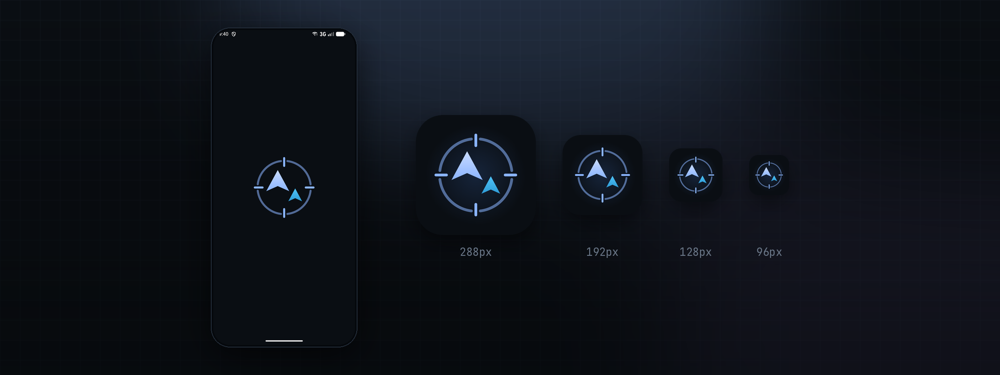
<br/><br/>
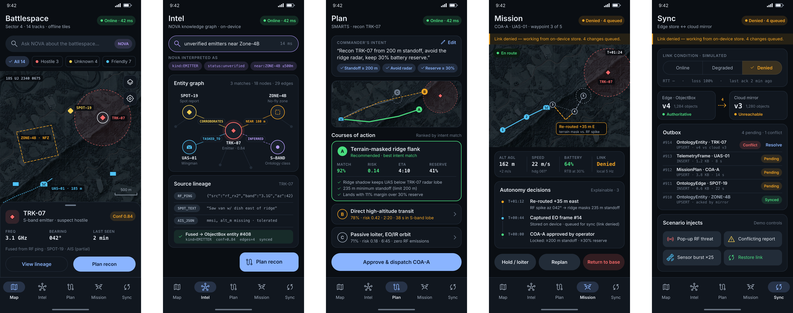
<br/><sub>Design renders (above) vs. the real app on device (top of page)</sub>
</div>

---

## ▶ Build & run

**Requirements:** JDK 17+, Android SDK 37, and a device or emulator on API 28+.

```bash
git clone https://github.com/andreij6/wingman-c2.git
```

```bash
cd wingman-c2 && ./gradlew :app:installDebug
```

For a release build with R8:

```bash
./gradlew :app:assembleRelease
```

### 90-second demo script

1. **Map:** tap **TRK-07**, then **Plan recon**.
2. **Plan:** review the three COAs and their explanations, then **Approve & dispatch COA-A**.
3. **Sync:** set the link to **Denied**, then tap **Pop-up RF threat**.
4. **Mission:** watch the UAS re-route by itself and log *why*.
5. **Sync:** tap **Conflicting report**, **Resolve** the conflict, then **Restore link** and watch the outbox drain.

---

## ⌂ Repository map

```
app/                      composition root, MainActivity, navigation shell
core/
  model/                  pure data: ontology, planning, mission, sync
  common/                 clock, dispatchers, formatting
  algorithms/             nlp · embedding · index · fusion · planning · geo · random · sync
  domain/                 ports + shared use cases
  simulation/             UAS physics, messy feeds, cloud mirror, link simulator
  database/               ObjectBox entities, stores, transactional outbox
  data/                   repositories, ingestion, mission runtime, sync engine
  designsystem/           theme, tokens, components
  ui/                     tactical map, entity graph, symbols, shared screen chrome
  navigation/             typed top-level routes
feature/{battlespace,intel,plan,mission,sync}/{domain,presentation}
build-logic/convention/   Gradle convention plugins
design/                   generated designs, renders, brand, screenshots, tooling
docs/ARCHITECTURE.md      full design document
```

<div align="center">
<br/>
<sub>Built with Kotlin, Jetpack Compose and a strong opinion that the edge should never wait on the cloud.</sub>
</div>
