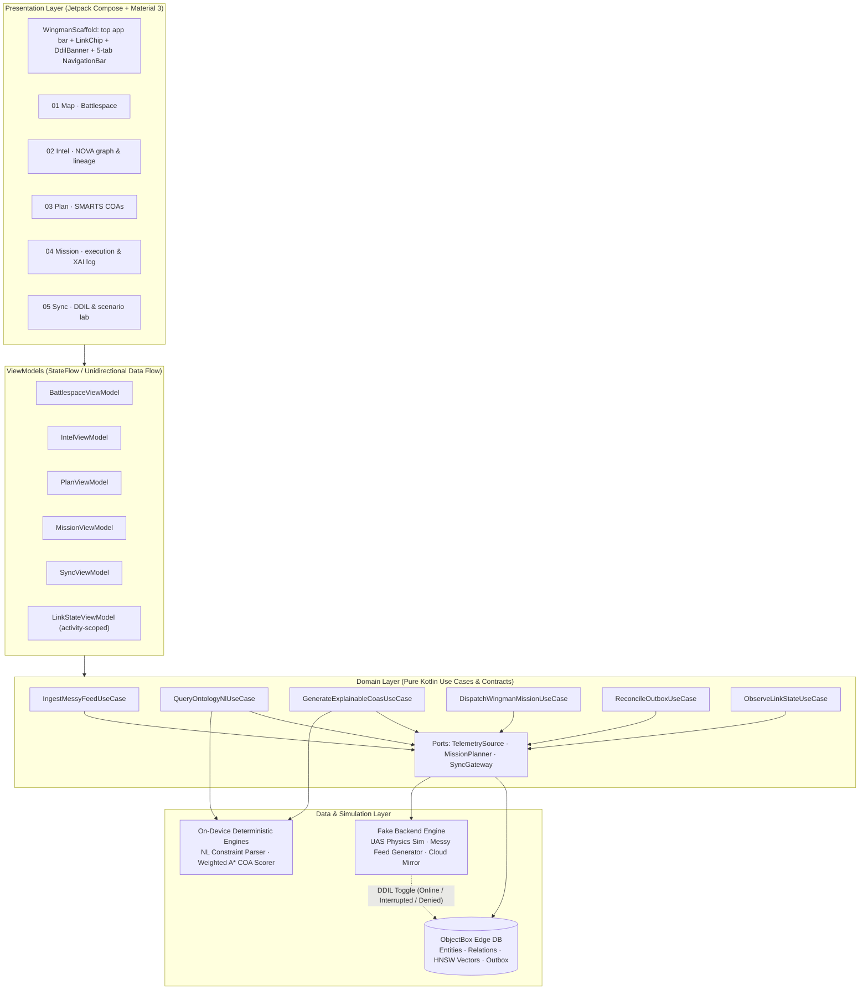
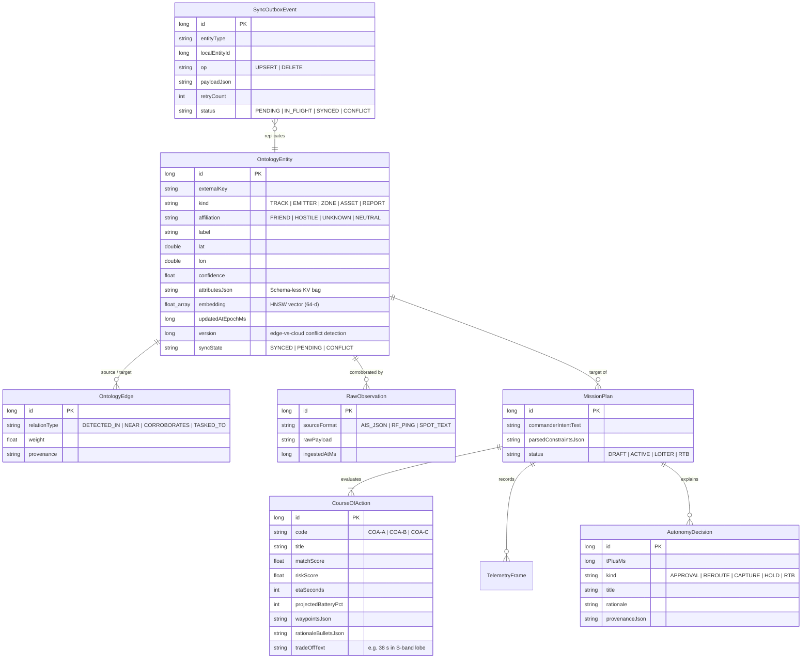

# Wingman C2 — High-Level Architectural Design

**Target Employer Alignment:** Machina Cognita Technologies (*Software Engineer - Android*, Vienna VA): native Android in Kotlin/Java, ObjectBox/SQLite edge persistence, Docker-ready backends, proof-of-concept demos for UAS / LLM / simulation work.  
**Designs:** [`design/wingman-c2.figcraft`](../design/wingman-c2.figcraft) · renders in [`design/renders/`](../design/renders/) · regenerate with `zsh design/tools/build.sh`  
**SBIR Concept Synthesis:**
- **NOVA** (*Natural-language Ontologies for battlespace Visualizations and Analytics*) — schema-less local C2 data fusion, entity/relationship knowledge graph, and natural-language querying.
- **SMARTS** (*State-based Machine Aided Real Time Strategy*) — plain-English commander intent translation into ranked, explainable Courses of Action (COAs) and human-on-the-loop UAS tasking.
- **DDIL Edge Resilience** — offline-first mobile persistence via **ObjectBox** with an in-process fake backend, simulated Cloud Mirror, and toggleable Denied, Disrupted, Intermittent, and Limited (DDIL) network conditions.

---

## 1. System Principles & Constraints

1. **Offline-First Edge Truth:** The Android device's **ObjectBox** store is the primary read/write source of truth for the UI. Network availability only governs background replication and external scenario sync.
2. **Swappable Fake Backend:** Every remote capability sits behind strict domain interfaces (`TelemetryStreamSource`, `OntologyIngestionService`, `MissionPlannerService`, `CloudSyncTransport`). The v1 demo runs 100% self-contained on-device via deterministic Kotlin Coroutine simulators (and optional in-process `MockWebServer`), with a clean swap path to Dockerized FastAPI / PostgreSQL / PX4 SITL containers.
3. **Explainable Autonomy (XAI) by Design:** Every AI recommendation (COA selection, threat alert, or autonomous replan) carries structured provenance, risk sub-scores, and human-readable doctrine rationales—never opaque black-box outputs.
4. **Demo-Ready Scenario Control:** The **Sync** screen lets an interviewer flip network connectivity, inject conflicting spot reports, or spawn pop-up RF threats in one tap.
5. **Link State Is Global:** One `LinkState` `StateFlow` drives the link chip in every top app bar and a DDIL banner on every screen, so an operator never has to open Sync to know they are disconnected.

---

## 2. Layered Clean Architecture & Module Structure

### Package Layout (`com.wingmanc2`)
* `core/ui` — Dark Material 3 theme and the shared components listed in §3 (`WingmanScaffold`, `LinkChip`, `DdilBanner`, `AffiliationSymbol`, …).
* `core/database` — ObjectBox `BoxStore` setup, entity definitions, HNSW vector indexing, outbox mutation interceptor.
* `core/sim` — Deterministic fake backend:
  * `SimulatedUasPhysicsEngine` (5 Hz telemetry `Flow`: lat/lon, heading, altitude AGL, airspeed, battery, link SNR).
  * `MessyFeedSimulator` (heterogeneous AIS/ADS-B JSON, RF emitter pings, free-text spot reports with missing/conflicting fields).
  * `SimulatedCloudMirror` (in-memory/SQLite secondary store simulating central C2 server state + latency/packet-loss/conflict injection).
* `feature/battlespace` — **Map**: NOVA search bar, affiliation filter chips, map canvas, entity bottom sheet (→ Intel / → Plan).
* `feature/intel` — **Intel**: NL query with parsed-predicate chips, entity graph, source lineage (raw inputs → fused ObjectBox entity).
* `feature/plan` — **Plan**: commander's intent + constraint chips, 3-route preview map, ranked COA cards, approve & dispatch.
* `feature/mission` — **Mission**: live route map, telemetry strip, explainable autonomy timeline, Hold / Replan / RTB overrides.
* `feature/sync` — **Sync**: link-condition segmented control, edge-vs-cloud version tiles, outbox with conflict resolve, scenario injects.

---

## 3. UI System (`core/ui`)

The redesign replaces per-card neon outlines with neutral surfaces and reserves color for meaning. Tokens live in one `WingmanColors` object and map 1:1 to the FigCraft foundations sheet (`design/renders/00-foundations.png`).

**Navigation.** Five `NavigationBar` destinations, one per screen: Map · Intel · Plan · Mission · Sync. The demo flow runs left to right: pick TRK-07 on the map → check its lineage → plan the recon → fly it → show sync under DDIL.

**Color roles.**

| Role | Used for | Never used for |
|---|---|---|
| `primary` #8AB4FF | Interactive elements, selection, primary buttons | Status |
| `ai` #B79CFF | Machine output: NOVA query bar, parsed predicates, inferred edges | Buttons |
| `ok` / `caution` / `critical` | Link and sync status, recommended COA, conflicts, RTB | Decoration |
| Affiliation: friendly #4FC3F7 · hostile #FF6B6B · unknown #F7D154 · neutral #6EDB8F | Map symbols and graph nodes only (MIL-STD-2525-inspired frames: rectangle / diamond / quatrefoil / square; air assets use the dome frame) | Anything outside the battlespace picture |

**Type.** Inter for UI (Title 22 · Headline 18 · Card title 15 · Body 14 · Label 12 · Overline 11 caps). Monospace only for data the operator compares: telemetry, IDs, coordinates, raw payloads.

**Shared composables.** `WingmanScaffold`, `LinkChip`, `DdilBanner`, `AffiliationSymbol`, `MapTag`, `EntitySheet`, `PredicateChip`, `CoaCard` (expanded/collapsed), `TelemetryStrip`, `DecisionTimeline`, `OutboxRow`. Icons are Material Symbols.

**Map.** v1 draws on a Compose `Canvas` over a bundled, dimmed terrain raster with a 1 km grid; symbols, threat rings, zones and routes are vector overlays. Upgrade path: MapLibre Native with offline MBTiles (see §6).

---

## 4. ObjectBox Edge Data Model & Vector/Graph Schema

ObjectBox is used natively (no ORM impedance mismatch) for **relational entity linking**, **HNSW semantic search**, and **transactional sync queuing**:

---

## 5. Fake Backend & DDIL Simulation Mechanics

Instead of hardcoding static UI lists, the fake backend behaves like a real distributed system:

| Simulated Component | Real-World Counterpart | How It Works Locally (Zero Server Required) |
|---|---|---|
| **UAS Telemetry Stream** | MAVLink / PX4 over gRPC or WebSocket | Kotlin `flow { while (active) { stepPhysics(); emit(frame); delay(200) } }` advancing drone position along chosen COA waypoints, computing wind/battery drain and radar line-of-sight. |
| **Messy Sensor Ingestion** | Kafka / TAK / Aegis data bus | Bundled scenario packs emit staggered, noisy JSON/text observations (e.g., mismatched coordinate formats, missing altitude, free-text spot reports) normalized into `OntologyEntity` + `OntologyEdge` in ObjectBox. |
| **Natural Language Query** | NOVA Ontology + LLM/BERT Service | Deterministic query parser extracts temporal (`last 15m`), spatial (`near Sector 4`), and status (`unverified`) predicates, combined with **ObjectBox HNSW vector similarity** over pre-embedded concept vectors. Returns a `ParsedQuery` (predicates + latency) that Intel shows as chips, so the interpretation is visible and correctable. |
| **Explainable COA Engine** | SMARTS RL/Doctrine Planner | Intent tokenizer maps phrases (`"200m standoff"`, `"avoid radar"`, `"30% battery"`) to cost-function weights; a fast 2D grid A* planner generates 3 distinct trajectories (Stealth/Masked, Direct/Fast, Endurance/Loiter) with explicit trade-off rationales. |
| **Cloud Mirror & Outbox** | Dockerized FastAPI + Postgres/Neo4j | Writes always commit to ObjectBox + `SyncOutboxEvent`. When `LinkMode == ONLINE`, a background worker drains the outbox to `SimulatedCloudMirror` (with 150–400ms simulated RTT). When `LinkMode == DDIL_OFFLINE`, events queue locally and reconcile automatically on reconnect—including scripted version conflicts for live demo resolution. |

---

## 6. Production Upgrade Path (Post-Demo)

When transitioning from POC to a fielded pilot or Dockerized evaluation environment:
1. **Swap `CloudSyncTransport`:** Replace `SimulatedCloudSyncTransport` with `Retrofit`/`OkHttp` (or gRPC) pointing at a Dockerized FastAPI + PostgreSQL (`pgvector`) service.
2. **Swap `MissionPlannerService`:** Route intent strings to a server-hosted SMARTS RL/LLM inference container while keeping the on-device A* planner as the **DDIL disconnected fallback**.
3. **Swap `TelemetryStreamSource`:** Bind to real MAVLink/ATAK CoT (Cursor on Target) UDP/TCP streams without touching any ViewModel or Compose screen.
4. **Swap the map renderer:** Replace the Canvas + bundled raster with MapLibre Native and offline MBTiles; overlays keep the same `AffiliationSymbol` / route models.
